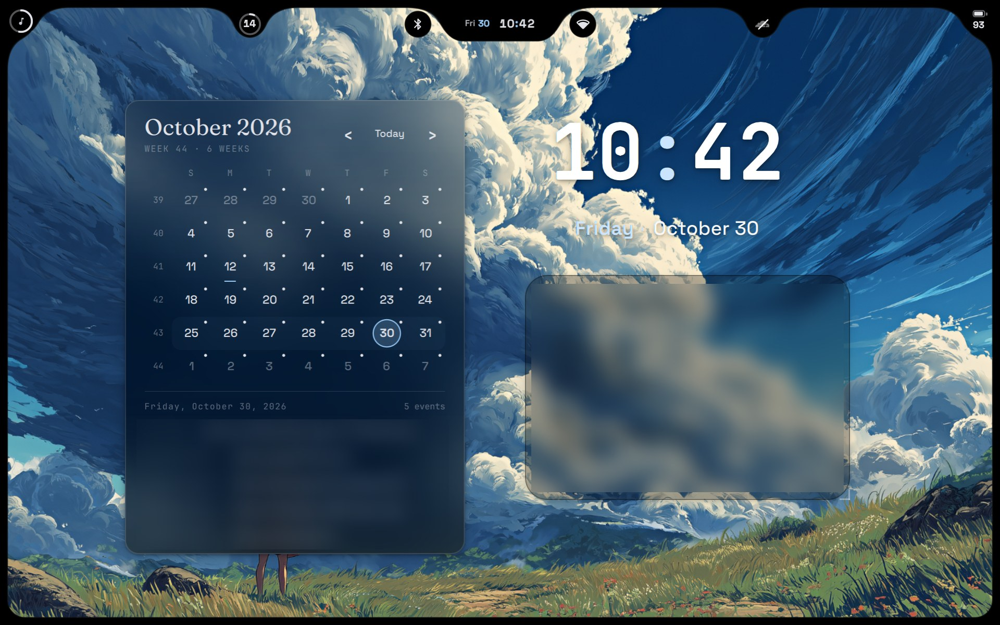
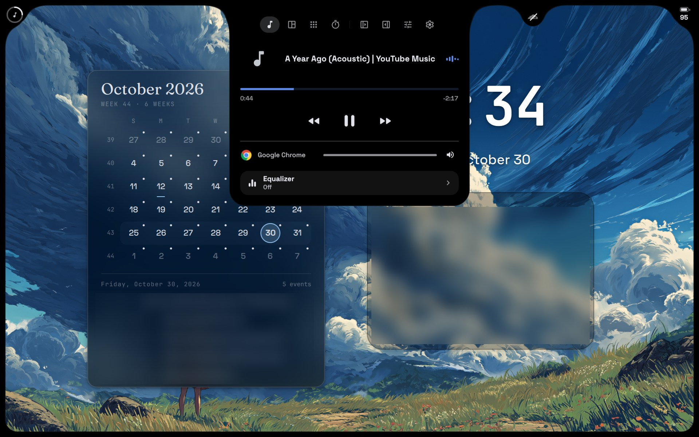
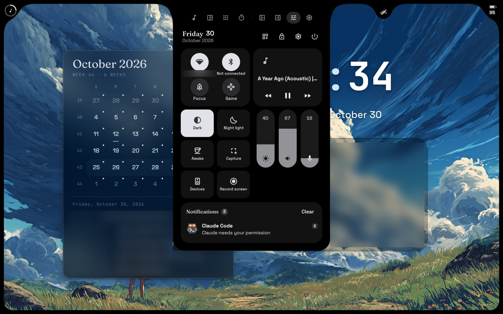
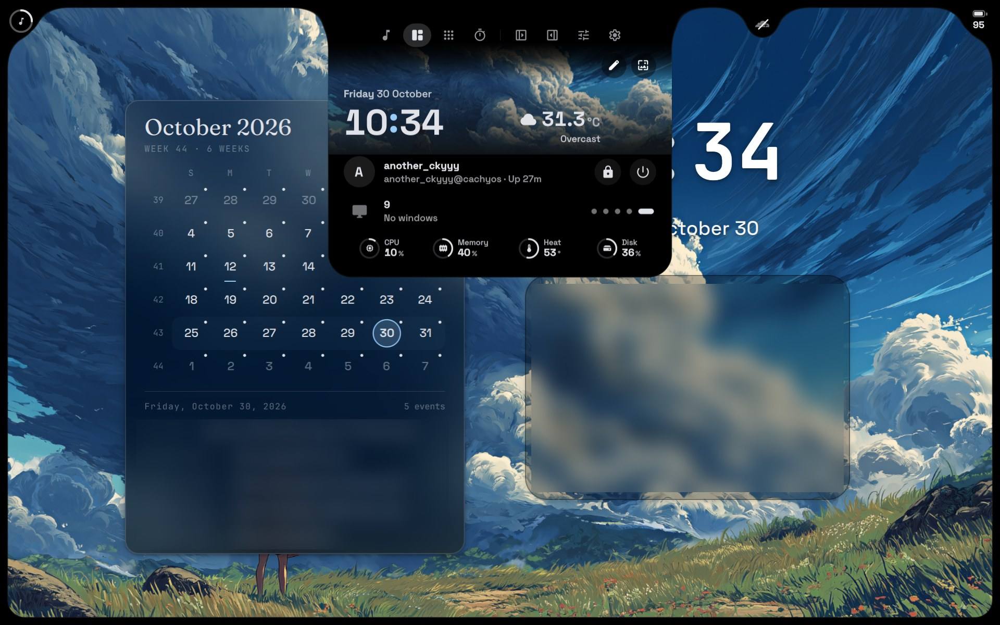
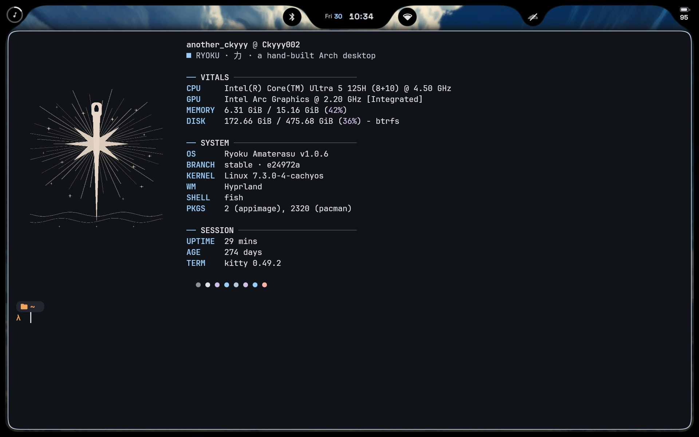
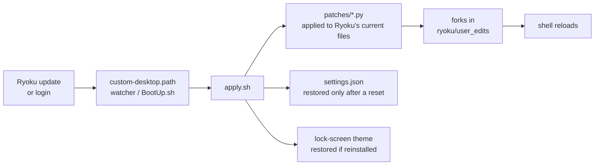

<div align="center">

# 力 &nbsp;hyprland-rice

**A calm, glassy Hyprland desktop on Ryoku Linux — with a living top-bar Island, floating bubbles, and tweaks that survive every update.**




<sub>Personal calendar events and notes are blurred in these screenshots.</sub>

</div>

---

## ✦ Gallery

<table>
  <tr>
    <td width="50%"></td>
    <td width="50%"></td>
  </tr>
  <tr>
    <td align="center"><b>The Island — Now Playing</b><br><sub>Click the notch and it morphs into a player with an equalizer.</sub></td>
    <td align="center"><b>Control Center</b><br><sub>Toggles, sliders and notifications fall straight out of the bar.</sub></td>
  </tr>
  <tr>
    <td width="50%"></td>
    <td width="50%"></td>
  </tr>
  <tr>
    <td align="center"><b>Desktop page</b><br><sub>Clock, weather, session and live CPU / memory / heat / disk.</sub></td>
    <td align="center"><b>kitty + fastfetch</b><br><sub>Framed windows inside the rounded screen border.</sub></td>
  </tr>
</table>

---

## ✦ What's in it

| | |
|---|---|
| **Island top bar** | Ryoku's *iris* bar in Cluster mode: a notched Island with the clock, flanked by Bluetooth and Wi-Fi bubbles. |
| **Floating bubbles** | Music (top-left), a **Timers bubble** that appears only while a timer runs, tray, and battery — each placed by hand. |
| **Timers that make sense** | The timer gets its own bubble with a filling progress ring instead of stealing the music bubble; clicking it shows time left with pause / stop. A gong rings when it's done. |
| **One-click Wi-Fi** | The Wi-Fi bubble opens the list of nearby networks, not the whole Control Center. |
| **Desktop widgets** | Calendar with events, a big clock, and a notes pad — typing in it no longer hides the bars. |
| **Lock screen** | The *r1999-2* [qylock](https://github.com/Darkkal44/qylock) theme with a rising curtain on <kbd>Super</kbd>+<kbd>L</kbd>, a gold shine and circle reveal on unlock, and running timers shown under the clock. |
| **Quieter OSD** | Volume and brightness show in the Island only (no second box at the bottom), without swallowing nearby bubbles. |
| **Update-proof** | Every tweak is re-applied automatically after a Ryoku update — see below. |

---

## ✦ How it survives updates

Ryoku rewrites its shell files on every update, so nothing here edits them in place. Instead each tweak is a small **patch script** that is re-applied to Ryoku's *newest* file:



- **Patches are anchored, not diffed.** Each script looks for an exact snippet; if a future Ryoku release changes it, the patch steps aside, Ryoku's own file is used, and the reason is logged to `~/.local/state/custom-desktop.log`. Your desktop never breaks — at worst one tweak pauses.
- **Settings respect you.** `settings.json` only puts a value back when a reset returned it to Ryoku's default; anything you change in Settings stays.
- **One-command repair:** `bash ~/Scripts/restore-config.sh`.

<details>
<summary><b>The patches</b></summary>

| Patch | Ryoku file | What it does |
|---|---|---|
| `calendar.py` | `IrisSidebarSection.qml` | Right-panel calendar uses the desktop widget's events |
| `notes.py` | `NotesWidget.qml` | Smaller notes text |
| `osd.py` | `OsdWindow.qml` | Hides the bottom volume/brightness box under iris |
| `dnd.py` | `Notifications.qml` | iris Do Not Disturb also silences banners |
| `btleft.py` | `IrisIsland.qml` | Bluetooth bubble on the left, mirroring Wi-Fi |
| `timerisland.py` | `IrisIsland.qml` | Running timer leaves the music bubble alone |
| `islandrest.py` | `IrisIsland.qml` | Volume/brightness popups don't merge nearby bubbles |
| `timerstage.py` | `IrisStage.qml` | Timers bubble only while a timer runs |
| `timerring.py` | `IrisBubbleFace.qml` | Timers bubble progress ring fills |
| `toolsclock.py` | `IrisTools.qml` | Timers card shows time left, pause and stop |
| `notestyping.py` | `Desktop.qml` | Notes announce typing like other text fields |
| `irisbar.py` | `IrisBar.qml` | Bars lift above the desktop while a widget is typing |

</details>

---

## ✦ Install

> [!IMPORTANT]
> This is a rice **for [Ryoku Linux](https://github.com/Ryoku-dev/ryoku)** (Hyprland edition). The patches modify Ryoku's Quickshell shell, so they won't do anything on a plain Hyprland setup.

```bash
git clone https://github.com/Ckyyy002/hyprland-rice
cd hyprland-rice
./install.sh
```

`install.sh` backs up anything it replaces to `~/.local/state/hyprland-rice-backup-<date>/`, copies the files into place, downloads the timer gong (needs `yt-dlp` + `ffmpeg`), installs the update watcher and applies everything.

Then pick the bits that live in Ryoku's GUI: the **Cluster** Island, bubble positions and the wallpaper are set in **Settings → Bar** and Island edit mode.

---

## ✦ Keybinds

| Keys | Action |
|---|---|
| <kbd>Super</kbd> + <kbd>L</kbd> | Lock with the rising curtain |
| <kbd>Super</kbd> + <kbd>Shift</kbd> + <kbd>L</kbd> | Suspend |
| <kbd>Super</kbd> + <kbd>Esc</kbd> | Control Center |
| <kbd>Super</kbd> + <kbd>N</kbd> | Left (focus) panel |
| Brightness keys | Level shown in the Island |

---

## ✦ Layout

```
hyprland-rice/
├── custom-desktop/          → ~/.config/custom-desktop
│   ├── apply.sh             re-applies everything (idempotent)
│   ├── patches/             one small Python patch per tweak
│   ├── settings.json        settings restored after a reset
│   ├── restore_settings.py  writes them through the ryoku-shell daemon
│   ├── qylock/r1999-2/      lock-screen theme edits
│   ├── unlock-reveal/       curtain + reveal overlay (Quickshell)
│   └── sounds/get-gong.sh   fetches the timer ringtone
├── hypr/user.lua            → ~/.config/hypr/user.lua  (keybinds, rules, startup hook)
├── scripts/                 → ~/Scripts  (BootUp.sh, restore-config.sh)
├── systemd/                 update watcher units (installed by restore-config.sh)
└── install.sh
```

---

<div align="center">

**System** · CachyOS kernel · Hyprland 0.57 · Ryoku Amaterasu 1.0.6 · Quickshell · kitty · fish

Built on the wonderful [**Ryoku**](https://github.com/Ryoku-dev/ryoku) desktop, the [**iNiR**](https://github.com/snowarch/inir) shell behind its *iris* bar, and [**qylock**](https://github.com/Darkkal44/qylock) lock screens — all credit for the base goes to their authors.

<sub>Made with too many late nights by <a href="https://github.com/Ckyyy002">@Ckyyy002</a></sub>

</div>
